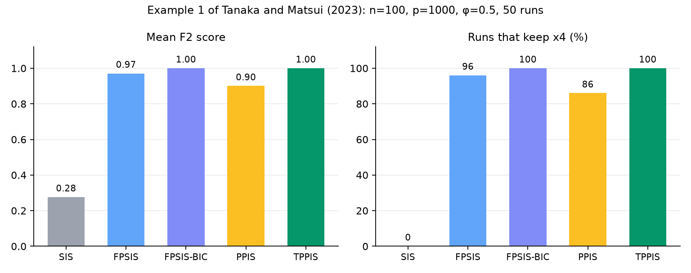

# tppis

Python implementation of Truncated Preconditioned Profiled Independence Screening
(Tanaka and Matsui, 2023), plus SIS, FPSIS, FPSIS-BIC and PPIS.

The package implements the screening methods of Tanaka and Matsui (2023).
Algebraic identities (`TPPIS` at `α = 1` equals `PPIS`) are tested. See
[Theory](theory.md) for the equations.

```python
from tppis import TPPIS, make_example1

data = make_example1(n=80, p=40, phi=0.5, seed=0)
est = TPPIS(d=4, alpha=0.6, k=4).fit(data.X, data.y)
print(est.get_support(indices=True))
```

## Results on Example 1



Table 1 setting n = 100, p = 1000, φ = 0.5, averaged over 50 simulated datasets,
with every parameter chosen by BIC. The true predictor x4 has zero marginal
correlation with y, so SIS never finds it; the factor-based methods recover it.
Redraw with `python reproduction/make_readme_figure.py`.
